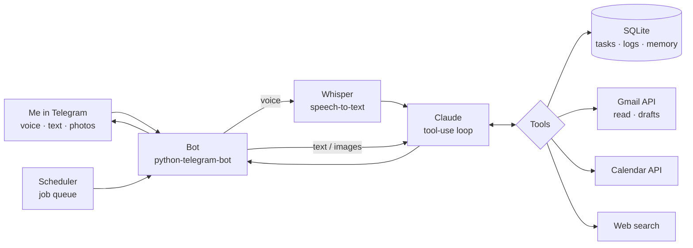

# Personal AI assistant on Telegram

A Telegram bot I built and use every day as my personal assistant and coach. I talk to it the way I'd talk to a human assistant, mostly in **voice notes on the go**, and it turns them into tasks, calendar events, email drafts and a plan for the day.

Built with **Claude** (reasoning and tool use), **Whisper** (speech-to-text), the **Telegram Bot API** and **Google Gmail / Calendar APIs**. It has run on a small cloud server since September 2026.

> This repo is a **showcase**: the README plus a curated set of clean modules. The full bot (~8k lines) lives in a private repo, because its prompts and data are built around my own life.

<!-- screenshots: replace with real ones from docs/screenshots/
| Voice note → plan | Inbox triage | Food log from a photo |
|---|---|---|
|  |  |  |
-->

## What it does

- 🎙 **Voice first.** Send a rambling voice note; Whisper transcribes it and Claude pulls out every task, date and decision.
- ✅ **Tasks like a real assistant.** Adds to-dos without asking, sets priority, area and deadline, and merges duplicates phrased differently.
- 📅 **Calendar.** "Block Friday morning for filming" becomes a real Google Calendar event; relative dates are resolved to exact times.
- 📬 **Inbox triage.** Reads two Gmail accounts (work is read-only), surfaces only what matters and prepares reply drafts. It **never sends** email on its own.
- 🍽 **Food and training log.** A photo of a meal becomes a protein and calorie estimate; a weekly training plan gets an evening check-in.
- 🧠 **Long-term memory.** Durable facts ("prefers morning workouts", "decided X") are saved and fed back into every conversation.
- 🌐 **Web search** when a question needs fresh information.
- ⏰ **Proactive rhythm.** It messages first on a schedule: a morning digest, habit and training check-ins, an end-of-day summary and a Sunday review.

## How it works

1. Every message (or transcribed voice note) goes to Claude with a cached system prompt: who I am, my goals and what the bot remembers about me.
2. Claude decides which tools to call. The loop in [`claude_client.py`](src/claude_client.py) runs them, returns the results and repeats until Claude has a final answer.
3. A job queue sends scheduled messages, so the bot starts conversations instead of just answering.

## Design decisions

- **Model routing by task.** Haiku for cheap high-volume work (inbox triage, classification), Sonnet for everyday conversation, Opus for deep weekly reflection.
- **Prompt caching.** The persona and memory prompt is cached for an hour, so a long, rich context costs almost nothing per message.
- **Safe by default.** Work email is read-only at the OAuth-scope level, email is drafted but never sent, and the bot answers only its owner.
- **Headless-friendly auth.** Google tokens are created once locally and refreshed on the server, so nothing ever waits for a browser.
- **Non-blocking.** Synchronous Google clients run in threads, so buttons respond even while Claude is still writing.

## Code in this repo

| File | What it shows |
|---|---|
| [`src/claude_client.py`](src/claude_client.py) | Tool definitions, prompt caching, adaptive thinking and the tool-use loop (a subset of the ~20 production tools) |
| [`src/whisper_client.py`](src/whisper_client.py) | Voice-note transcription |
| [`src/gmail_client.py`](src/gmail_client.py) | Reading mail and creating threaded reply drafts |
| [`src/calendar_client.py`](src/calendar_client.py) | Creating, listing and deleting events |
| [`src/google_auth.py`](src/google_auth.py) | Two Google accounts with different OAuth scopes, refreshed without a browser |

## Stack

Python · Claude API (Anthropic SDK) · OpenAI Whisper · python-telegram-bot · Gmail & Google Calendar APIs · SQLite · systemd on a cloud server

---

Built by [Elina Zubova](https://github.com/elina-zubova) · [Portfolio](https://elina-zubova.vercel.app)
